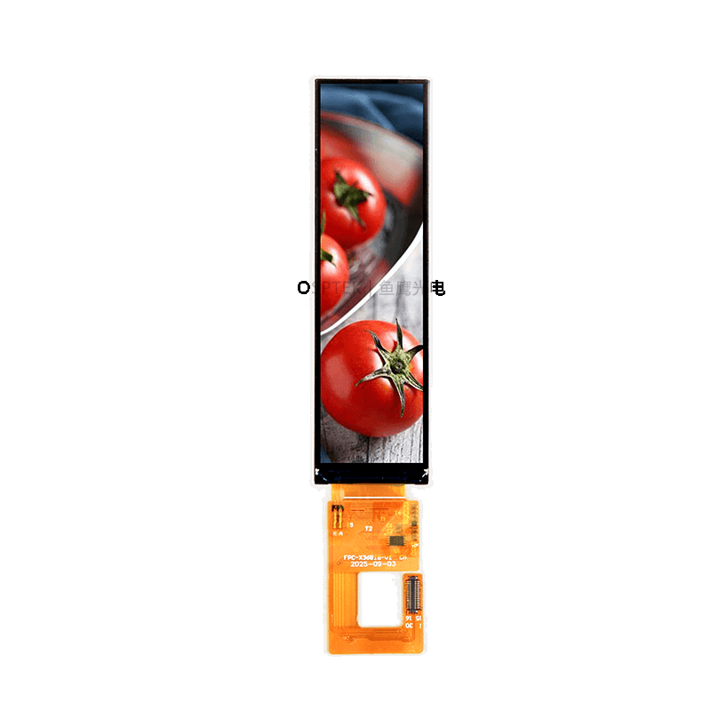

<p align="left"></p>

<h1 align="center">OSPTEK 3.42″ TFT Display 258×960 (YDP342B001-V13)</h1>

<p align="center"><b>TFT module · MIPI · AXS15231B</b></p>

<p align="center"><a href="./README.md">简体中文</a> | English · <a href="../../README_EN.md">Family index</a></p>

<p align="center">
  
  
</p>

<p align="center"></p>

## Contents

- [Specifications](#specifications)
- [Resources](#resources)
- [Repository layout](#repository-layout)
- [Buy](#buy)
- [Support](#support)

---

## Specifications

| Item | Spec |
| ---- | ---- |
| Size | 3.42 inch |
| Type | TFT |
| Resolution | 258×960 |
| Outline | — |
| Active area | 22.56 x 84 mm |
| Interface | MIPI |
| Driver IC | AXS15231B |
| Touch IC | — |

> Full outline, FPC definition, power, and timing follow the product datasheet / driver IC datasheet.

## Resources

| Category | File |
| ---- | ---- |
| Datasheet | [`AXS15231_Datasheet_preliminary 2022.04.26.pdf`](./datasheets/AXS15231_Datasheet_preliminary%C2%A02022.04.26.pdf) |
| Datasheet | [`YDP342B001-V13.pdf`](./datasheets/YDP342B001-V13.pdf) |
| CAD file | [`YDP342B001-V13.dwg`](./cad/YDP342B001-V13.dwg) |
| CAD file | [`YDP342B001-V13_外形图.pdf`](./cad/YDP342B001-V13_%E5%A4%96%E5%BD%A2%E5%9B%BE.pdf) |

## Repository layout

```text
display-tft-3.42inch-258x960/ # repo root (nav: ../../README_EN.md; sample projects under root examples/)
└── versions/
    └── YDP342B001-V13/        # full materials for this part number
        ├── README.md
        ├── README_EN.md
        ├── osptek.yml
        ├── images/
        ├── datasheets/       # product datasheet + driver/touch IC datasheets
        └── cad/              # outline/cover CAD
```

## Buy

See the [repo home page](../../README_EN.md#where-to-buy).

## Support

See the [repo home page](../../README_EN.md#support).

---

<p align="center"><sub>© 2026 OSPTEK · Materials in this repository are licensed under CC BY 4.0</sub></p>
